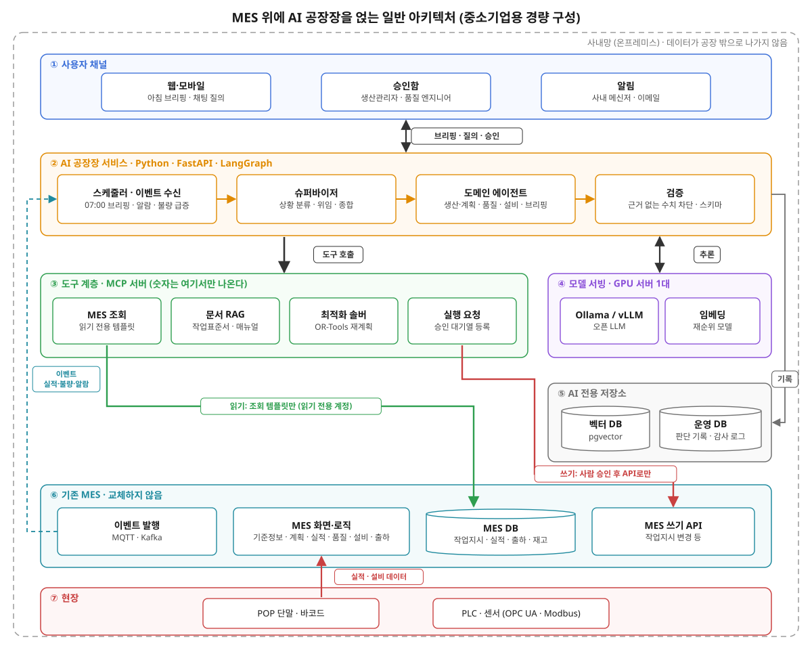
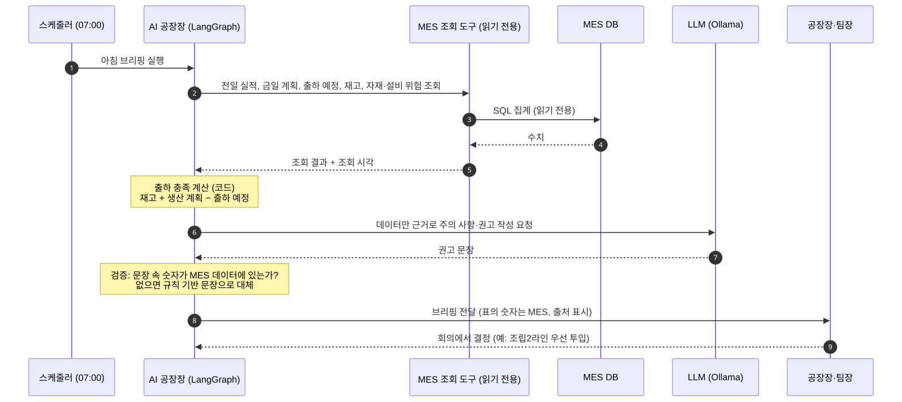
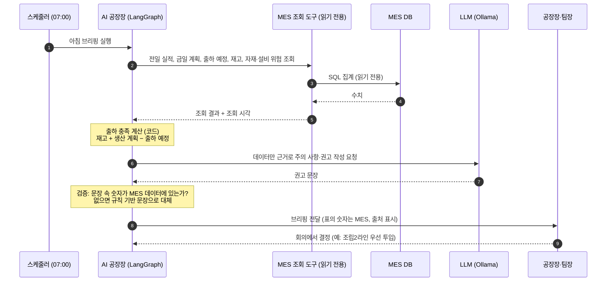

# 강의안: 중소기업 MES와 AI 공장장

> **형식:** 50분 (발표 35분 + MES 데모 15분), 실습 없음
> **청중:** IT 엔지니어
> **장표 수:** 14~16장
> **관련 자료:** [AI 공장장 보고서](../ai-plant-manager.md) · [아침 브리핑 데모 코드](../demo/morning-briefing/)

---

## 1. 핵심 메시지

> **"MES는 공장의 몸과 신경이고, AI 공장장은 그 위에 얹히는 두뇌다. AI는 MES를 대체하지 않는다. MES 데이터가 판단과 행동으로 이어지게 만든다."**

청중(IT 엔지니어)이 가져갈 결론은 **"MES를 AI가 쓸 수 있게(AI-ready) 만들려면 무엇을 설계해야 하는가"**다.

### 오프닝 통찰

> **"중소기업 MES의 가장 큰 문제는 기능이 아니라, 입력되지 않는 데이터와 아무도 보지 않는 대시보드다."**

AI는 이 양쪽 끝을 모두 고칠 수 있다.
- **입력 쪽:** 음성·사진 입력, 자동 수집 보완, 입력 이상 탐지
- **활용 쪽:** 브리핑, 자연어 질의, 원인 분석, 추천

---

## 2. 시간 배분

| 시간 | 구간 | 내용 | 장표 |
|---|---|---|---|
| 0~3분 | 오프닝 | "여러분이 만든 MES 대시보드, 현장에서 몇 명이나 볼까요?" + 오프닝 통찰 | 2장 |
| 3~11분 | 중소기업 MES 개관 | 모듈 지도, 데이터 성격, 시간 계층 | 3장 (A~C) |
| 11~26분 | 🖥️ **MES 데모 (15분)** | 모듈 시연 + 'AI 렌즈' 멈춤 지점 4곳 | 표지 1장 |
| 26~33분 | 모듈별 AI 활용 지도 | 어느 모듈에 어떤 AI를 어떤 수준으로 | 2장 (D~E) |
| 33~43분 | ⭐ **AI 공장장: 개념과 시나리오** | 정의, 자율성 단계, 하루, 시나리오 2개 (+ 브리핑 데모 녹화 30~60초) | 4장 (F~I) |
| 43~48분 | 아키텍처와 AI-ready MES | MES 위에 AI를 얹는 구조, 엔지니어용 설계 원칙 | 2장 (J~K) |
| 48~50분 | 마무리 | 기억할 세 문장 | 1장 |

> **데모를 중간에 두는 이유:** MES를 먼저 보여주면, 청중이 뒤의 AI 이야기를 방금 본 화면 위에 겹쳐서 상상할 수 있다. 데모 중에 던진 "여기에 AI가 붙으면?"이라는 질문에 후반부 AI 공장장 시나리오가 답하는 구조다.

---

## 3. 장표별 내용

### 오프닝 (2장)

- **장표 1:** 제목 — 「중소기업 MES 위에 AI 공장장을 얹는다」 (부제: 어떤 분야에서 AI를 어떻게 활용할 것인가)
- **장표 2:** 질문과 통찰 — "입력되지 않는 데이터, 아무도 보지 않는 대시보드" / AI가 고치는 양쪽 끝

### 장표 A: 중소기업 MES 모듈 지도

```
┌─────────────── 중소기업 MES (ERP 기능 일부 포함이 일반적) ───────────────┐
│ [기준정보]  품목 · BOM · 공정/라우팅 · 설비 · 작업자 · 거래처 · 불량코드    │
├────────────────────────────────────────────────────────────────────┤
│ [영업·수주] → [생산계획·작업지시] → [작업실적(POP)] → [품질검사] → [출하]    │
│                     ↕                  ↕              ↕               │
│               [자재·재고(LOT)]     [설비·비가동]     [불량·클레임]         │
├────────────────────────────────────────────────────────────────────┤
│ [모니터링·KPI]  생산현황 · OEE · 불량률 · 납기   [추적성]  LOT 역추적       │
├────────────────────────────────────────────────────────────────────┤
│ [데이터 수집]  POP 단말 · 바코드/QR · PLC/센서(OPC UA, Modbus) · 수기 입력   │
└────────────────────────────────────────────────────────────────────┘
```

### 장표 B: 모듈별 데이터의 성격

| 모듈 | 핵심 데이터 | 데이터 품질 문제 (중소기업 현실) |
|---|---|---|
| 기준정보 | 품목, BOM, 표준 사이클타임 | 표준값이 실제와 다름, 개정 누락 |
| 생산계획·작업지시 | 작업지시, 우선순위 | 엑셀로 따로 관리, 현장에서 순서를 임의로 바꿈 |
| 작업실적(POP) | 시작·종료, 수량, 작업자 | 몰아서 입력, 누락, 시간 부정확 |
| 품질 | 검사 결과, 불량 유형 | "기타" 불량 남발, 원인 미기록 |
| 설비 | 가동·비가동, 보전 이력 | 비가동 사유 미입력, 정비 내용이 자유 서술 |
| 자재·재고 | 입출고, LOT | 실물과 전산 재고의 불일치 |

### 장표 C: 시간 계층

| 시간 | 담당 | AI 역할 |
|---|---|---|
| ms~초 | PLC, 설비 제어, 안전 | ❌ AI가 관여하지 않음 |
| 초~분 | MES 실시간 처리(실적 수집, 알람) | 이상 감지 ML 정도 |
| **분~일** | **운영 판단(재계획, 원인 분석, 정비 일정)** | ⭐ **LLM 에이전트(AI 공장장)의 영역** |
| 주~월 | 계획, 개선, 보고 | 최적화 + LLM |

### MES 데모 (15분): 'AI 렌즈' 멈춤 지점

데모 시작 전 표지 장표: **"데모 중 ⏸ 표시가 나오면, AI가 들어갈 자리입니다."**

| 데모 화면 | 멈춤 멘트 (예시, 각 30초) | 뒤에서 회수할 내용 |
|---|---|---|
| 작업지시·생산계획 | "지금 긴급 주문이 들어오면, 이 순서를 누가 어떻게 다시 짤까요?" | 시나리오 ① 긴급 주문 끼워 넣기 |
| 작업실적·불량 입력 | "여기 '기타 불량'이 쌓이면, 원인은 영영 모릅니다." | 입력 쪽 AI, 시나리오 ② 불량 원인 분석 |
| 설비 비가동 | "비가동 사유 칸이 비어 있죠. 알람 이력과 정비 이력은 따로 놉니다." | 알람 진단 에이전트 |
| 모니터링 대시보드 | "이 화면을 매일 아침 보는 사람이 있다면, AI 공장장은 그 사람에게 먼저 말을 거는 대시보드입니다." | 아침 브리핑 (데모 녹화) |

### 장표 D: 모듈별 AI 활용 지도

| MES 모듈 | AI 기술 | 활용 예 | 자율성 | 중소기업 난이도 |
|---|---|---|---|---|
| 기준정보 | 통계, LLM | 실적과 표준 사이클타임 차이 탐지, 기준정보 갱신 제안 | L2 | ⭐ 낮음 (효과 큼) |
| 생산계획 | 최적화 솔버 + LLM | 긴급 주문 재계획 시나리오, 납기 영향 설명 | L2~L3 | 중간 |
| 작업실적(POP) | 음성·비전 입력, 이상 탐지 | 말이나 사진으로 실적·불량 입력, 누락과 이상값 경고 | L1~L2 | 낮음 |
| 품질 | ML, LLM, RAG | 불량 급증 시 4M 원인 후보, 8D 초안, 검사 기준 질의 | L2 | 중간 |
| 설비 | 이상 감지 ML, RAG | 알람 원인 진단, 매뉴얼 기반 조치 가이드, 정비 일정 제안 | L2 | 중간 |
| 자재·재고 | 예측, LLM | 결품 위험 경고, 발주 제안 | L2 | 중간 |
| 모니터링 | LLM | 아침 브리핑, 교대 보고서, 자연어 질의("2라인 어제 왜 느렸어?") | L1 | ⭐ 낮음 (가장 먼저 할 것) |

### 장표 E: 핵심 통찰 3가지

1. **가장 쉬운 곳에서 효과가 가장 크다.** 브리핑, 자연어 질의, 기준정보 보정은 읽기 전용이라 위험이 낮고 바로 체감된다.
2. **가치는 모듈 사이에 있다.** 하나의 모듈 안에서 보다 여러 모듈을 엮을 때(실적 + 품질 + 설비 + 자재) AI의 가치가 커진다. 이것이 'AI 공장장'이 필요한 이유다.
3. **AI 품질의 상한은 MES 데이터 품질이다.** 그래서 입력 쪽 AI가 결국 활용 쪽 AI의 성능을 끌어올린다.

### 장표 F: AI 공장장의 정의와 자율성 단계

- **정의:** 공장장의 판단 루프(상황 파악 → 진단 → 판단 → 검증 → 지시 → 학습)를 공장 전체 범위에서 수행하는 AI. **최종 책임은 사람.**
- **자율성 단계:** L1 참모 → L2 추천 → L3 승인형 실행 → L4 조건부 자율 → L5 다크팩토리
- **현실:** 지금은 L1~L3. L5는 정부 2028~29년, 삼성 2030년 목표.
- **정책 동향:** 과기정통부·중기부 '모두의 AI 공장장'(2026.09). 중소기업 물류 로봇에서 시작해 통합 운영 시스템, 다크팩토리 OS로 확장하는 계획. *(강의 직전에 최신 보도 재확인)*

### 장표 G: AI 공장장의 하루

> 가상의 중소기업: 직원 60명 규모, 자동차 부품 사출·조립 2차 협력사

| 시각 | AI 공장장 | 사용하는 MES 모듈 |
|---|---|---|
| 06:30 | 야간 근무조 실적, 불량, 비가동 정리 | 실적, 품질, 설비 |
| 07:00 | **아침 브리핑**: 전일 생산·출하 실적, **당일 생산 계획 수량과 출하 예정 수량 집계**, 출하 충족 여부, 오늘의 위험(자재 지연 가능성, 3호기 이상 징후) | **생산계획·작업지시, 작업실적, 출하, 재고**, 설비 |
| 09:40 | 사출기 알람 → 매뉴얼과 과거 정비 이력으로 원인 후보와 조치 가이드 | 설비 + RAG |
| 10:15 | 긴급 주문 접수 → 재계획 시나리오 3개 → 생산관리자 승인 → 작업지시 반영 | 수주, 계획, 자재, 설비 |
| 15:30 | 불량률 급증 → 4M 원인 분석 → "금형 온도 편차와 상관관계 높음" | 품질, 실적, 설비, 자재 LOT |
| 18:00 | 교대 보고서, 미결 사항 인계 | 전체 |

#### 아침 브리핑 화면 예시 (가상 데이터, 데모 코드 출력과 동일)

> **📋 10월 20일(화) 아침 브리핑**: AI 공장장, 07:00 기준
>
> **1. 전일 실적 (10/19)**
> | 구분 | 계획 | 실적 | 달성률 |
> |---|---|---|---|
> | 생산 | 12,000개 | 11,280개 | 94.0% |
> | 출하 | 9,500개 | 9,500개 | 100% |
>
> **2. 금일 계획 (10/20)**
> | 품목 | 생산 계획 | 출하 예정 | 완제품 재고 | 출하 충족 |
> |---|---|---|---|---|
> | A-101 (사출) | 5,000 | 4,800 | 1,200 | ✅ 여유 1,400 |
> | B-205 (조립) | 3,000 | 3,500 | 300 | ⚠️ 부족 200 |
> | C-310 (사출) | 4,000 | 2,000 | 2,500 | ✅ 여유 4,500 |
> | **합계** | **12,000** | **10,300** | | |
>
> **3. 주의 사항**
> - ⚠️ B-205 출하 200개 부족 예상 → 오전 중 조립 2라인 우선 투입 권고
> - ⚠️ 자재 A 입고 지연 가능성 (공급사 납기 회신 미수신) → 구매팀 확인 필요
> - ⚠️ 3호기 사출기 진동 상승 추세 → 점심시간 점검 권고
>
> *모든 수치는 MES 기준 (작업지시, 실적, 출하계획, 재고)*

**이 장면으로 전달할 메시지**

| 메시지 | 이 장면에서 보이는 것 |
|---|---|
| 숫자는 MES에서 | 집계는 LLM이 계산하지 않는다. MES 조회 도구가 가져오고 출처와 조회 시각을 표시한다 |
| 가치는 모듈 사이에 있다 | 생산계획, 출하, 재고는 MES에서 서로 다른 화면이다. 세 모듈을 엮어야 "B-205 200개 부족"이 나온다 |
| AI는 해석과 권고를 | 부족 원인을 설명하고 권고를 만든다. 결정은 회의에서 사람이 한다 |
| 가장 먼저 시작할 기능 | 읽기 전용 조회 + LLM 요약만으로 가능하다. 위험이 가장 낮은 L1 참모 단계 |

### 장표 H: 시나리오 ① 긴급 주문 끼워 넣기

```
영업: "C사 긴급 300개, 목요일 출하"
  → AI 공장장: 주문 해석 → [자재 재고] [설비 정비 일정] [실제 사이클타임] 병렬 조회
  → 솔버로 시나리오 3개 계산 (정비 연기 / 잔업 / 다른 주문 연기)
  → 납기·비용·위험 비교 + 권고안 + 근거
  → 생산관리자 승인 → MES 작업지시 순서 변경, 잔업 공지, 영업에 납기 회신
```

메시지: **"일정 계산은 솔버가, 해석과 조율은 LLM이, 결정은 사람이."**

### 장표 I: 시나리오 ② 불량 급증 원인 분석

```
품질 모듈: 오후 불량률 2배
  → AI 공장장 → 품질 에이전트: 해당 시간대 LOT, 작업자, 설비 조건, 자재 LOT 조회
  → 4M 관점 원인 후보 순위 (근거 데이터와 과거 유사 사례 첨부)
  → 품질 엔지니어 검증 → 조치 지시 → 결과를 사례로 축적
```

메시지: **"모듈 하나만 봐서는 안 보이는 원인이, 모듈을 엮으면 보인다."**

### 장표 J: MES 위에 AI 공장장을 얹는 구조 (중소기업용 경량 구성)

```
[사용자] 웹·모바일 (브리핑, 채팅, 승인함)
   ▼
[AI 공장장]  LangGraph 슈퍼바이저 → 생산 / 품질 / 설비 에이전트      (파이썬)
   ├─ MES 조회 도구 (MCP, 읽기 전용 템플릿)  ← 숫자는 MES에서
   ├─ 문서 RAG (작업표준서, 설비 매뉴얼, 불량 이력)
   ├─ 솔버 (OR-Tools)
   └─ 실행 요청 → 승인 대기열 → MES API (작업지시 변경 등)  ← 쓰기는 승인 후에만
   ▼
[모델]  Ollama 또는 vLLM + 오픈 모델 (GPU 1장 서버로 시작 가능, 데이터가 공장 밖으로 나가지 않음)
[MES]   기존 MES DB와 API (교체하지 않음)
```

#### 일반 아키텍처 그림

중소기업 MES에 AI 공장장을 얹을 때 예상되는 일반적인 구성이다. 모든 구성요소가 **사내망(온프레미스)** 안에 있고, 기존 MES는 그대로 둔 채 **읽기는 조회 도구로, 쓰기는 승인 대기열을 거쳐서만** 연결한다.



> 그림 원본: [`images/architecture.svg`](./images/architecture.svg) (장표에 그대로 삽입 가능). 수정하려면 [`images/make_architecture_svg.py`](./images/make_architecture_svg.py)에서 배치와 문구를 고친 뒤 다시 생성한다.

| 계층 | 역할 | 기술 예시 | 설계 포인트 |
|---|---|---|---|
| ① 사용자 채널 | 브리핑 열람, 질의, 승인 | 웹·모바일, 사내 메신저 | 승인함은 따로 둔다. AI가 제안하고 사람이 누른다 |
| ② AI 공장장 서비스 | 상황 분류, 위임, 종합, 검증 | Python, FastAPI, LangGraph | 정기 실행(07:00 브리핑)과 이벤트 실행(알람, 불량 급증)을 모두 받는다 |
| ③ 도구 계층 | MES 조회, 문서 검색, 계산, 실행 요청 | MCP 서버, OR-Tools | **숫자는 여기서만 나온다.** 조회는 읽기 전용 템플릿, 쓰기는 승인 대기열에 등록만 한다 |
| ④ 모델 서빙 | LLM 추론, 임베딩 | Ollama 또는 vLLM, 오픈 모델 | GPU 1장으로 시작. 데이터가 공장 밖으로 나가지 않는다 |
| ⑤ 데이터 계층 | 원천 데이터, 문서 색인, 판단 기록, 이벤트 | MES DB, pgvector, Postgres, MQTT·Kafka | 판단 기록과 감사 로그는 AI 서비스 쪽 DB에 따로 남긴다 |
| ⑥ 기존 MES | 기준정보, 계획, 실적, 품질, 설비, 출하 | 기존 시스템 그대로 | **교체하지 않는다.** 조회 API와 쓰기 API, 이벤트 발행만 갖추면 된다(장표 K) |
| ⑦ 현장 | 실적 입력, 설비 데이터 수집 | POP, 바코드, PLC, OPC UA | 실시간 제어는 PLC와 MES가 맡는다. AI는 관여하지 않는다 |

#### 아침 브리핑 처리 흐름

위 구성에서 07:00 아침 브리핑이 만들어지는 순서다. [데모 코드](../demo/morning-briefing/)는 이 흐름을 축소해 구현했다.



<details>
<summary>Mermaid 원본 (GitHub에서 바로 렌더링됨, <code>images/briefing-sequence.mmd</code>)</summary>



</details>

### 장표 K: AI-ready MES 체크리스트 ⭐

| # | 설계 원칙 | 왜 필요한가 |
|---|---|---|
| 1 | 조회 API를 표준화하고 의미 있는 이름을 쓴다 (`get_line_status`, `get_lot_history`) | AI가 도구로 쓰기 쉬움. MCP 서버로 노출하기도 쉬움 |
| 2 | 이벤트를 발행한다 (실적, 불량, 알람, 비가동) | AI가 사건에 즉시 반응하려면 이벤트가 필요함 (예: MQTT, Kafka) |
| 3 | 쓰기 API에 승인 단계와 감사 정보를 둔다 (누가, 무엇을, 왜) | AI의 제안이 사람 승인을 거쳐 실행되게 하는 장치 |
| 4 | 멱등성을 지킨다 | 재시도해도 작업지시가 두 번 생기지 않게 |
| 5 | 기준정보 품질 지표를 관리한다 (표준과 실제 사이클타임의 차이 등) | AI 판단 품질의 상한을 결정함 |
| 6 | 자유 서술 칸을 줄이고 코드화한다 (불량, 비가동 사유) | 원인 분석이 가능해짐 |
| 7 | 문서를 디지털로 관리하고 개정판을 관리한다 (작업표준서, 매뉴얼) | RAG의 원료 |
| 8 | 권한을 역할 기반으로 나눈다 | AI가 사용자 권한 이상의 정보를 보거나 행동하지 않게 |

### 마무리 (1장): 기억할 세 문장

1. **AI는 MES를 대체하지 않고, MES 위의 두뇌가 된다.**
2. **숫자는 MES와 솔버에서, 해석과 연결은 LLM이, 결정은 사람이.**
3. **AI-ready MES는 오늘 설계할 수 있다.** API, 이벤트, 승인, 기준정보 품질부터 시작하자.

---

## 4. 준비 팁

| 항목 | 팁 |
|---|---|
| 시간 관리 | 데모가 길어지기 쉽다. '멈춤 지점 4곳'만 확실히 지키고 세부 기능은 건너뛴다. 장표 F~I(AI 공장장)는 줄이지 않는다 |
| 가상 회사 통일 | 데모 MES의 샘플 데이터와 시나리오의 가상 회사를 같은 회사로 맞추면 데모와 AI 공장장 이야기가 하나로 이어진다 |
| 브리핑 데모 | [아침 브리핑 데모](../demo/morning-briefing/)를 미리 실행해 **30~60초 녹화본**을 만들어 둔다. 현장에서는 `--no-llm` 백업 모드로도 시연 가능 |
| 수치와 정책 | '모두의 AI 공장장', 삼성 2030 같은 내용은 강의 직전에 최신 보도를 다시 확인한다 |

### 예상 질문과 답변

| 질문 | 답변 요지 |
|---|---|
| 보안은? | 온프레미스 LLM(Ollama, vLLM)으로 데이터가 공장 밖으로 나가지 않는다. AI 계정은 읽기 전용, 쓰기는 승인 후에만 |
| GPU 비용은? | 24~32GB GPU 1장 서버로 시작할 수 있다. 브리핑 같은 요약 업무는 작은 모델로도 충분 |
| 기존 MES를 바꿔야 하나? | 아니다. 조회 API와 MCP로 MES 위에 얹는다 |
| 환각은? | 숫자는 MES 도구에서만 가져오고, 출처를 표시하고, 근거 없는 수치는 검증 단계에서 걸러낸다. 실행은 승인을 거친다 |
| 어디서부터 시작하나? | 아침 브리핑, 자연어 질의 같은 읽기 전용 L1 기능부터. 그다음 기준정보 보정, 알람 진단 순으로 |
