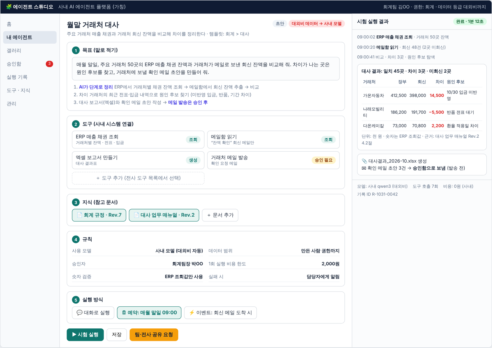

# 사내 AI 에이전트 플랫폼 도입 제안 (경영진 보고 근거 문서)

> 작성일: 2026-11-16 · 수정: 2026-11-17 (비용 재산정: 파일럿 1억 원 이하, 1년차 5억 원 이하 · 효과를 처리 능력·품질 중심으로)
> 보고 자료: [슬라이드 v2](./ai-agent-platform-proposal-v2.pptx) (23장, 최신: 문제점 분석 및 제안 요약, 시나리오 3가지, MCP 설명, 구조와 보안, 기대 효과 · 투자·구축 방식·리스크·검증은 부록) · [슬라이드 v1](./ai-agent-platform-proposal.pptx) (24장, 이전 비용 가정: 파일럿 3.4억 원) · [투자 효과 계산 엑셀](./ai-agent-platform-roi.xlsx) · [화면 시안](./ux/agent-studio-mockup.html)
> 전제: 직원 500~2,000명 규모 제조 기업 (계산 기준 1,000명) · LLM은 **혼합 운영** (민감 데이터는 사내 모델, 일반 업무는 클라우드 모델)
> 관련 자료: [AI 오케스트레이션 동향](../ai-orchestration-2026.md) · [AI 공장장](../ai-plant-manager.md) · [공장장실 구상](../ai-plant-manager-portal.md) · 데모: [아침 브리핑](../demo/morning-briefing/) · [지식 도우미](../demo/rag-indexer/) · [MES 도구 MCP 서버](../demo/mes-mcp/)

이 문서는 슬라이드의 **근거와 상세**를 담는다. 경영진의 질문에 답할 때 쓰고, 숫자는 모두 가정과 계산식을 함께 적었다. 회사의 실제 숫자(인원, 인건비, 견적)로 바꾸면 결과도 바로 바뀐다.

---

## 1. 한 장 요약

| 구분 | 내용 |
|---|---|
| **문제** | 직원들은 이미 범용 AI를 업무에 쓰고 있다. 그러나 ① 그때그때 대화하고 판단과 단계 연결(오케스트레이션)은 사람이 직접 해서 **비효율적**이고 ② 범용 AI 비용이 사람 수만큼 들지만 결과는 개인에 머물며 ③ 무엇보다 **회계·제조·품질·생산 데이터를 활용할 수 없어 한계가 분명**하다. 범용 MCP 도구는 넘쳐나지만 우리 데이터를 여는 도구는 없다. 승인되지 않은 도구로 회사 데이터가 흘러가는 문제(섀도 AI)도 있다 |
| **제안** | 직원이 **화면에서 자신의 AI 에이전트를 만들고, 실행하고, 동료와 공유하는** 사내 플랫폼(가칭 **에이전트 스튜디오**). 사내 시스템은 표준 도구(MCP)로 연결하고, 데이터 등급에 따라 사내 모델과 클라우드 모델을 나눠 쓰며, 시스템을 바꾸는 일은 사람이 승인한다 |
| **효과** | **같은 인원으로 더 많은 일을, 더 좋은 품질로**: 처리 건수·점검 범위 확대, 옮겨 적기 오류·누락 감소, 회신 시간 단축(8.1). 재무 계산은 보수적으로 시간 절감만 넣어도 기준 시나리오 **2년차 누적 손익분기, 3년 누적 +8.9억 원**. 보안: 섀도 AI를 공식 경로로 흡수. 경쟁력: 회계·제조·품질·개발 전 부서의 AI 활용을 하나의 기반 위에 쌓음 |
| **요청** | **1단계 파일럿 승인**: 6개월, **1억 원 이하(약 0.95억 원)**, 품질·영업·회계 3개 부서 + 전사 일상업무 Q&A. 6개월 뒤 정해 둔 지표로 확대 여부(Go/No-go)를 결정 |

핵심 메시지: **"직원들은 이미 AI를 쓰고 있다. 문제는 쓰느냐가 아니라, 우리 데이터에 연결해 회사가 통제하고 쌓아 가는 방식으로 쓰느냐다."**

---

## 2. 왜 해야 하는가: 할지 말지가 아니라 어떻게 할지의 문제

AI 활용은 이미 시작됐다. 경영진이 고를 수 있는 것은 "도입하느냐"가 아니라 **"회사가 주도하느냐, 방치하느냐"**다. 회사가 주도해야 하는 이유는 다섯 가지다.

| # | 당위성 | 설명 | 하지 않으면 |
|---|---|---|---|
| 1 | **직원은 이미 쓰고 있다** | 범용 AI를 그때그때 대화로 쓰고, 일의 연결은 사람이 한다(4.2). 승인되지 않은 도구를 쓰는 직원도 절반 가까이 된다(4.1). 더 나은 업무 방식과 안전한 공식 경로를 줘야 한다 | 비효율이 굳고, 회사 데이터가 통제 밖 외부 서비스로 계속 흘러간다 |
| 2 | **범용 AI는 우리 회사를 모른다** | 모델은 누구나 같은 것을 산다. 차이는 **우리 ERP·MES 데이터와 업무 지식(규정·사례·노하우)을 AI에 연결하는 능력**에서 난다. 이 연결은 외부에서 사 올 수 없고 회사가 만들어야 한다 | AI 활용 수준이 경쟁사와 같아지고, 차별화 요소가 남지 않는다 |
| 3 | **현업의 일은 IT가 다 자동화해 줄 수 없다** | 부서마다 수십 개의 작은 반복 업무가 있다. IT 개발 요청으로는 몇 달씩 기다리거나 아예 우선순위에 들지 못한다. **업무를 가장 잘 아는 사람이 직접 만드는 방식**이어야 속도가 난다 | 자동화는 큰 과제 몇 개에 머물고, 작은 비효율이 그대로 남는다 |
| 4 | **노하우가 사람과 함께 떠난다** | 숙련자의 판단 기준과 과거 대응 사례는 문서보다 사람 머리에 있다. 에이전트와 지식으로 담으면 퇴직·이동 후에도 남는다 | 숙련자가 떠날 때마다 같은 시행착오를 반복한다 |
| 5 | **부서별 개별 도입은 더 비싸다** | 부서마다 다른 AI 서비스를 따로 계약하면 비용이 중복되고, 보안 기준이 제각각이며, 만든 것이 서로 재사용되지 않는다. **기반은 하나, 활용은 부서별로**가 가장 싸다 | 중복 계약, 보안 구멍, 사내 시스템 연결 작업의 부서별 반복 |

> 우리 회사 숫자로 채우면 설득력이 커진다: 최근 5년 내 퇴직 예정 숙련 인력 수, IT 개발 요청 대기 건수와 평균 대기 기간, 부서별로 이미 따로 결제 중인 AI 서비스 수와 금액, 외부 AI 서비스 접속 트래픽(보안팀).

**한 문장으로:** 지금 하지 않아도 AI는 쓰인다. 다만 **회사 밖에서, 제각각, 아무것도 남기지 않고** 쓰일 뿐이다.

---

## 3. 가장 그럴싸한 사용 시나리오: 고객 품질 클레임 대응

### 3.1 왜 이 시나리오인가

여러 후보(월말 대사, 아침 브리핑, 규정 Q&A 등) 가운데 경영진이 가장 쉽게 "우리 회사 이야기"로 받아들이는 장면을 골랐다.

- **자주 일어나고, 모두가 아는 고통이다.** 클레임 하나에 품질·생산·물류·영업이 함께 움직이고, 첫 회신이 늦으면 고객 신뢰가 깎인다.
- **여러 시스템을 넘나든다.** MES(LOT·공정·검사), ERP(출하·재고·고객), 메일, 과거 사례 문서. 사람이 하면 부서마다 물어보며 하루가 간다. 에이전트가 가장 잘하는 일이다.
- **플랫폼의 모든 기능이 한 장면에 나온다.** 사건 트리거, 사내 시스템 도구, 지식 검색, 데이터 등급별 사내 모델, 사람 승인, 공유와 축적.
- **결과를 검증하기 쉽다.** 첫 회신까지 걸린 시간, 출하 보류 판단 시간처럼 파일럿에서 바로 잴 수 있다.
- **이미 데모로 구조를 확인했다.** MES 조회 도구와 "제안 → 승인 → 실행" 흐름은 [MES 도구 MCP 서버 데모](../demo/mes-mcp/)에서, 과거 사례 검색은 [지식 도우미 데모](../demo/rag-indexer/)에서 동작을 확인했다.

### 3.2 장면: 오전 9시, 고객사 클레임 메일이 도착했다

> 아래 시각과 수치는 이해를 돕기 위한 **예시**다. 실제 효과는 파일럿에서 잰다.

| 시각 | 무슨 일이 일어나나 | 플랫폼 기능 |
|---|---|---|
| **09:10** | 고객사 품질팀 메일: "커넥터 단자 변형 불량 3건, LOT 2611-A". 품질팀이 만들어 둔 **클레임 대응 에이전트**가 메일 도착을 감지해 시작한다 | 사건 트리거 |
| **09:12** | 에이전트가 MES에서 LOT를 추적한다: 11월 3일 2라인, 프레스 3호기, 금형 교체 직후 2시간 생산분. 같은 조건으로 만든 LOT 4개를 찾고, ERP에서 그중 2개(1,200개)가 아직 창고에 있음을 확인한다 | MES·ERP 조회 도구 |
| **09:15** | 당시 공정 데이터와 검사 기록을 확인하고, 사내 사례에서 **비슷한 클레임 2건**(2024년 금형 교체 후 단자 변형)과 그때의 대책을 찾는다. 고객 정보와 품질 데이터는 대외비이므로 **사내 모델**로 처리한다 | 지식 검색 · 데이터 등급별 모델 |
| **09:20** | 품질 담당자에게 정리본이 온다: 원인 후보(금형 교체 후 초품 검사 누락 가능성), 영향 범위, 8D 보고서 초안(D1~D4), 그리고 **제안 2건**: ① 창고 재고 2개 LOT 출하 보류 ② 고객 1차 회신 초안 | 보고서 초안 · 제안 |
| **09:40** | 담당자가 근거(MES 조회값, 과거 사례 문서)를 확인하고 회신 문구를 고친 뒤 **승인**한다. 출하 보류가 MES에 등록되고, 회신 메일이 나간다(AI 생성 표시 포함) | 승인함 · 실행 기록 |
| **이후** | 원인이 확정되면 대책이 사례 지식으로 쌓여 다음 클레임 때 검색된다. 다른 공장 품질팀은 갤러리에서 이 에이전트를 가져다 자기 라인에 맞게 쓴다 | 지식 축적 · 갤러리 공유 |

### 3.3 지금과 무엇이 달라지나

| 구분 | 지금 | 플랫폼 이후 (예시) |
|---|---|---|
| 고객 1차 회신 | 다음 날 (LOT 추적과 영향 범위 파악에 하루) | **당일 오전** |
| 미출하 재고 보류 | 영향 범위가 확정된 뒤 | **첫 30분 안에 제안** → 사람이 승인 |
| 담당자의 일 | 생산·물류·영업에 묻고, 시스템을 오가며 복사·붙여넣기 | **근거 확인과 판단**, 회신 문구 다듬기 |
| 과거 사례 활용 | 기억하는 사람이 있으면 | 매번 자동으로 찾아 근거로 붙임 |
| 남는 것 | 담당자 메일함 | 실행 기록, 승인 이력, 대책이 담긴 사례 지식 |

**경영진에게 전할 메시지:** AI가 결정하는 것이 아니다. **찾고, 맞추고, 초안을 쓰는 일을 AI가 하고, 판단과 승인은 사람이 한다.** 그 결과 같은 사람이 더 빨리, 더 근거 있게 대응한다.

### 3.4 직원 한 명, 에이전트 여러 개: 품질팀 김 대리의 "내 에이전트"

클레임 대응 에이전트는 김 대리가 만든 여러 에이전트 중 하나다. 직원은 자기 업무에 필요한 에이전트를 **원하는 만큼** 만든다.

| 에이전트 | 실행 방식 | 어떻게 생겼나 | 공유 범위 | 지난 30일 |
|---|---|---|---|---|
| 고객 클레임 대응 | 사건: 클레임 메일 도착 | 직접 만듦 | 전사 (검토됨) | 7회 |
| 아침 불량 현황 | 예약: 매일 07:30 | 직접 만듦 | 팀 | 21회 |
| 검사 기준 Q&A | 대화 | 직접 만듦 | 팀 | 64회 |
| 8D 보고서 초안 | 대화 | 갤러리에서 가져옴 | 개인 | 5회 |
| 주간 품질 보고 초안 | 예약: 금 16:00 | 템플릿으로 만듦 | 개인 (시험 중) | 4회 |
| 협력사 성적서 점검 | 사건: 성적서 메일 | 직접 만듦 | 보관 (90일 미사용) | 0회 |

> 설명용 가상 예시. 화면 시안의 "내 에이전트" 메뉴에 해당한다.

원칙: **원하는 만큼 만든다**(개인용은 자유, 권한은 언제나 내 권한까지) · **나누는 것은 검토를 거친다**(팀 공유는 팀장, 전사 공개는 AI 추진 조직) · **기록을 보고 고친다**(실행 횟수·성공률·동료 평가, 버전 관리) · **안 쓰면 정리된다**(90일 미사용 시 보관, 담당이 바뀌면 인계).

### 3.5 에이전트 관리 절차: 만들고 · 고치고 · 나누고 · 정리한다

| 단계 | 직원 (만든 사람) | 팀장 (승인자) | AI 추진 조직 (플랫폼) |
|---|---|---|---|
| ① 찾기·만들기 | 갤러리에서 검색해 가져오거나 템플릿으로 새로 만든다 (개수 제한 없음) | 팀에 필요한 에이전트를 요청·추천 | 부서 템플릿·도구·지식 제공, 부서 챔피언 교육 |
| ② 시험·저장 | 시험 실행으로 결과와 근거를 확인하고 저장 | 쓰기 도구(메일 발송·시스템 변경)를 쓰면 승인자로 지정 | 데이터 등급·권한 자동 검사 |
| ③ 운영 | 대화·예약·사건으로 실행하고 결과를 쓴다 | 승인함에서 제안을 승인·반려 | 실행 기록·비용 한도 관리 |
| ④ 점검·개선 | 실행 기록·성공률·동료 평가를 보고 목표·규칙·지식을 고친다 (버전 관리) | 월 1회 팀 에이전트 현황 점검 | 실패·비용 이상 알림, 도구 개선 |
| ⑤ 공유 | 잘 되는 에이전트를 팀·전사에 공유 요청 | 팀 공유 승인 | 전사 공개 전 검토 (권한·프롬프트·데이터 등급) |
| ⑥ 정리 | 안 쓰는 에이전트는 보관, 담당이 바뀌면 인계 | 인사이동 시 소유권 인계 확인 | 90일 미사용 휴면 알림, 중복 에이전트 통합 |

**직원은 자유롭게 만들고, 회사는 기록·검토·정리로 관리한다.** 그래서 에이전트가 수백 개로 늘어도 통제가 무너지지 않는다.

### 3.6 다른 부서로 넓히면: 대표 시나리오 3가지 (품질 · 영업 · 회계)

| 구분 | 품질 · 고객 클레임 대응 (3.2) | 영업 · 긴급 주문 납기 회신 | 회계 · 월말 거래처 대사 (6.2, 화면 시안) |
|---|---|---|---|
| 시작 | 고객사 클레임 메일 도착 (사건) | 고객의 긴급 주문 문의 메일 도착 (사건) | 매월 말일 09:00 (예약) |
| 연결 데이터 | MES LOT·공정·검사, ERP 출하·재고, 과거 클레임 사례 | ERP 수주·재고, MES 생산 계획·설비 가동, 자재 재고 | ERP 매출채권·전표·입금, 거래처 회신 메일, 회계 규정·대사 매뉴얼 |
| 에이전트가 하는 일 | LOT 추적·영향 범위 파악, 유사 사례 검색, 8D 초안, 출하 보류·1차 회신 제안 | 납기 가능 여부 계산, 대안(분할 납품·작업 순서 조정) 비교, 계획 변경 제안·회신 초안 | 50곳 잔액 비교, 차이 3곳 원인 후보, 대사 보고서·확인 메일 초안 |
| 사람이 하는 일 | 품질 담당: 근거 확인, 출하 보류·회신 승인 | 생산관리: 계획 변경 승인 · 영업 담당: 고객 회신 승인 | 회계 담당: 차이 판단 · 팀장: 확인 메일 발송 승인 |
| 지금 → 이후 (예시) | 1차 회신 다음 날 → 당일 오전 | 납기 회신 반나절~하루 → 30분 안 | 반나절 대사 → 차이 검토 30분 |
| 보여 주는 기능 | 사건 실행 · 지식 검색 · 사내 모델 · 승인 | 여러 시스템 계산 · 대안 비교 · 두 단계 승인 | 예약 실행 · 업무 규칙 · 화면 시안 |

**영업 시나리오 장면 (예시):** 고객사 구매 담당이 "다음 주 화요일까지 5,000개 추가 가능한가?"라고 메일을 보낸다. 지금은 영업 담당이 생산관리와 자재 담당에게 차례로 물어 회신까지 반나절~하루가 걸린다. 에이전트는 ERP 수주·재고, MES 생산 계획과 설비 가동, 자재 재고를 함께 보고 "화요일 3,000개 + 목요일 2,000개 분할 납품 가능, 또는 2라인 작업 순서를 바꾸면 화요일 전량 가능(다른 주문 1건 하루 지연)"처럼 대안을 비교해 올린다. 작업 순서 변경은 생산관리가, 고객 회신은 영업 담당이 승인한다. 작업 순서 변경 제안과 승인 흐름은 [MES 도구 MCP 서버 데모](../demo/mes-mcp/)의 `propose_work_order_reorder`로 구조를 확인했다.

세 시나리오 모두 구조가 같다: **사건·예약으로 시작 → 에이전트가 사내 데이터로 찾고·계산·초안 → 사람이 판단·승인.**

---

## 4. 지금 일어나는 일: 직원들은 이미 AI를 쓰고 있다

### 4.1 섀도 AI (승인되지 않은 AI 사용)

| 지표 | 수치 | 출처 |
|---|---|---|
| 업무 기기에서 AI 도구를 정기적으로 쓰는 직원 | **45%** (2025년 15%에서 3배) | Verizon 2026 DBIR (2차 보도) |
| 회사가 승인하지 않은 AI 도구를 쓰는 직원 | **49%** (500명 이상 기업, 영미 2,000명 조사) | BlackFog 2026 |
| 승인되지 않은 도구에 연구 자료·데이터셋을 넣어 본 직원 | **33%** (인사 정보는 27%) | BlackFog 2026 |
| 승인되지 않은 도구를 쓰는 비율: 임원 vs 직원 | **65% vs 31%** | TrustedTech·Censuswide |
| 침해 사고를 겪은 조직 중 섀도 AI 관련 사고 비율 | **43%** (전년 20%) · 평균 피해 539만 달러 (전체 평균 499만 달러) | IBM 2026 (2차 보도) |

- 국내 사례: 2023년 국내 대기업에서 직원이 소스 코드를 외부 생성형 AI에 입력해 사내 사용을 제한한 사례가 널리 보도됐다.
- **금지만으로는 막히지 않는다.** 임원조차 승인되지 않은 도구를 더 많이 쓴다. 더 편하고 안전한 **공식 경로**를 주는 것이 현실적인 대응이다.

> 섀도 AI 통계는 조사마다 정의(사용자 수 / 사고 건수 / 트래픽)가 달라 방향성 지표로 본다. 보고 전에 원 보고서(Verizon DBIR, IBM Cost of a Data Breach)로 재확인한다.

### 4.2 지금의 방식: AI와 그때그때 대화하고, 일의 연결은 사람이 한다

직원들이 범용 AI(ChatGPT, Copilot 등)를 업무에 쓰는 것은 맞다. 문제는 **쓰는 방식**이다. 지금은 사람이 판단하고 단계를 잇는 오케스트레이터 역할을 한다.

```
① ERP·MES 화면에서 조회, 엑셀로 내려받기            (사람)
② 필요한 부분만 복사, 민감 정보 지우기               (사람)
③ 범용 AI 대화창에 붙여넣고 상황 설명                (AI)
④ 답을 확인하고 모자란 데이터는 다시 조회             (사람)
⑤ 다음 질문으로 이어 가기 (맥락 다시 설명)           (사람)
⑥ 결과를 메일·보고서·시스템에 다시 옮기기            (사람)
   → 다음 일마다 ①~⑥ 반복
```

**AI가 하는 일은 여섯 단계 중 하나뿐이다.** 데이터를 찾고, 옮기고, 잇는 나머지 다섯 단계는 여전히 사람이 한다. 에이전트 플랫폼에서는 사람이 목표를 정하고 결과를 승인하며, 조회·연결·초안 작성은 에이전트가 도구로 직접 한다.

### 4.3 범용 AI 방식의 세 가지 한계

| 한계 | 현상 | 근거·예시 |
|---|---|---|
| **① 비효율: 사람이 일을 잇는다** | 매번 맥락을 다시 설명하고 결과를 옮긴다. 사람마다 방식과 결과가 달라 재현·공유되지 않는다. 정해진 시각이나 사건(불량 급증, 회신 도착)에 스스로 돌지 않는다 | 국내 조사: AI를 도입한 기업 69.5% vs **업무 표준으로 정착한 기업 12.5%** (조코딩AX파트너스, 2,078명) · AI 필요성 공감 78.4% vs 실제 활용 30%대 (대한상의 경제연구원, 2차 보도) |
| **② 비용: 범용 AI를 범용으로 쓴다** | 쓰는 만큼이 아니라 사람 수만큼 구독료가 나간다. 단순 반복 작업도 고가 모델과 긴 대화로 처리한다. 부서마다 따로 결제해 중복된다 | 예: 1인 월 4만 원 × 300명 = 연 1.4억 원 (회사 실제 결제 금액으로 확인할 것) |
| **③ 데이터: 우리 회사 데이터를 쓸 수 없다 (가장 큰 한계)** | 범용 AI는 **회계(전표·채권), 제조(공정·설비), 품질(검사·클레임), 생산(실적·계획·LOT)** 데이터에 닿지 못한다. 그래서 "이번 달 왜 불량이 늘었나", "어느 거래처 잔액이 안 맞나" 같은 우리 회사의 질문에 답하지 못하고 일반론과 문서 작성 보조에 머문다. 데이터를 통째로 붙여 넣으면 보안 위험, 일부만 넣으면 틀린 답이 나오고, 답에 나온 숫자의 근거를 확인할 수 없다 | 6장의 플랫폼은 이 데이터를 표준 도구(MCP)로 연결하고, 숫자는 시스템 조회값만 쓰며, 대외비는 사내 모델로 처리한다 |

**결론:** 필요한 것은 더 똑똑한 범용 AI가 아니라, **우리 데이터에 연결되고 스스로 단계를 이어 가는 업무용 에이전트**다. 플랫폼은 범용 AI를 버리는 것이 아니라, 그 위에 우리 데이터와 업무 절차를 잇는 층이다. 범용 모델은 모델 게이트웨이 뒤에서 일반 업무용으로 계속 쓴다.

### 4.4 AI 에이전트는 어떻게 회사 데이터를 쓰나: 글로벌 표준 MCP

경영진 보고에서는 MCP를 먼저 쉽게 설명한다.

```
[AI 에이전트]  ──부른다──▶  [MCP 도구: 거래처 잔액 조회 · LOT 추적 · 작업지시 변경 제안 ✋]  ──권한 확인 후 조회──▶  [ERP · MES · 그룹웨어]
(Claude·ChatGPT·                         ◀──결과(숫자)만 돌려준다──                     모든 호출 기록, ✋ = 사람 승인 필요
 Gemini·사내 모델)
```

| 질문 | 답 |
|---|---|
| **MCP란?** | AI와 회사 시스템을 잇는 **표준 연결 규격**. AI가 "할 수 있는 일"을 도구로 정해 둔다. 어떤 기기든 꽂으면 되는 USB-C 단자와 같다 |
| **AI는 어떻게 데이터에 접근하나?** | AI는 회사 DB를 직접 열지 않는다. ① AI가 도구를 부르고 ② 도구가 그 직원의 권한을 확인해 시스템에서 조회하고 ③ 결과(숫자)만 AI에 돌려주며 ④ 모든 호출을 기록한다. 시스템을 바꾸는 도구는 사람이 승인해야 실행된다 |
| **왜 필요한가?** | AI가 회사 데이터에 안전하게 닿는 길이다. 권한 안에서만, 기록을 남기며 접근한다. 한 번 만든 도구는 모든 에이전트가 재사용한다 |
| **글로벌 표준인가?** | 그렇다. 2024년 11월 공개된 뒤 2025년 12월 리눅스 재단 산하 Agentic AI Foundation으로 이관됐고, Claude·ChatGPT·Gemini·Copilot 등 주요 AI가 모두 지원한다. **특정 AI 회사에 묶이지 않으므로, 지금 만든 도구는 AI를 바꿔도 그대로 쓰는 회사 자산이 된다** |

### 4.5 MCP 도구는 넘쳐나지만, 우리 회사 데이터를 여는 도구는 없다

AI와 시스템을 잇는 표준(MCP) 도구는 이미 많이 공개돼 있다. 그러나 **실제 기업의 데이터를 활용하는 도구는 없다.**

| 구분 | 예시 | 상황 |
|---|---|---|
| **공개된 범용 MCP 도구** | 협업(메일·메신저·캘린더), 문서(클라우드 드라이브·위키), 개발(코드 저장소·이슈 관리), 일반(웹 검색·파일·범용 DB 질의) | **이미 많다.** 누구나 가져다 쓰고, 경쟁사도 똑같이 쓴다 |
| **우리 업무에 필요한 도구** | 회계: 거래처별 채권·전표 조회(우리 계정 체계) · 생산: LOT 추적·실적·작업지시(우리 LOT 규칙) · 품질: 검사 결과·클레임·불량 이력(우리 판정 기준) · 제조: 설비 알람·가동, 계획 변경 제안(승인 필요) | **어디에도 없다.** 직접 만들어야 한다 |

**왜 없는가**

1. **시스템이 회사마다 다르다.** 같은 ERP·MES 제품이라도 커스터마이징, 코드 체계, 테이블 구조가 다르다. 범용 DB 질의 도구로 붙여도 AI는 어떤 테이블의 어떤 값이 무슨 뜻인지 모른다.
2. **업무 규칙이 들어가야 한다.** 어떤 LOT를 "같은 조건으로 만든 것"으로 볼지, 대사 차이를 무엇으로 판단할지는 우리 회사의 기준이다. 이 규칙이 도구 안에 들어가야 답이 맞는다.
3. **권한과 승인이 필요하다.** 누가 어떤 데이터를 볼 수 있는지, 시스템을 바꾸는 일은 제안 → 승인 → 실행을 거쳐야 하는지를 도구가 지켜야 한다. 범용 도구는 이것을 모른다.

**그래서 이 도구가 회사의 AI 자산이다.** 우리 데이터를 여는 도구는 한 번 만들면 모든 에이전트가 재사용하고, AI 모델을 바꿔도 그대로 남는다. 경쟁사가 사 올 수 없는 차별화 요소다. 실현 가능성은 이미 확인했다: [MES 도구 MCP 서버 데모](../demo/mes-mcp/)에서 생산 실적·출하·설비·지식 조회와 작업지시 변경 제안(승인 필요) 등 도구 10개를 Python과 Java로 만들어 검증했다.

---

## 5. 왜 지금인가: 생존, 경쟁력, 그리고 직원 한 사람의 생산성

"업무 소프트웨어가 에이전트로 바뀐다"는 동향만으로는 지금 해야 할 이유가 약하다. 지금 시작해야 하는 이유는 세 가지다.

### 5.1 생존: 사람은 줄고, 일은 는다

- 2025년 1분기 제조업 기간제 취업자 중 60세 이상 비중은 **31.7%**로 2010년(7.1%)의 4배 이상이다(한국노동연구원 노동리뷰, 기간제 기준). 제조업 취업자 비중은 15% 아래로 내려갔고, 청년층은 줄고 50대 이상은 늘고 있다(2026년 보도).
- 숙련자가 떠나기 전에 그 판단 기준과 대응 사례를 **에이전트와 지식으로 남겨야** 같은 인원으로 일을 감당할 수 있다.
- 우리 회사 숫자로 바꾸면 더 강하다: 5년 내 퇴직 예정 숙련 인력 수, 부서별 충원 실패 건수.

### 5.2 경쟁력: 격차는 시간이 갈수록 벌어진다

- 국내 기업 **79.3%**가 2026년 생성형 AI 예산을 늘리지만(CIO Korea), AI를 업무 표준으로 정착시킨 기업은 **12.5%**다(조코딩AX파트너스).
- AI 모델은 경쟁사도 똑같이 산다. 차이는 **우리 데이터에 연결된 도구, 쌓인 지식, 운영 경험**에서 나는데, 이것은 사 올 수 없고 쌓는 데 시간이 걸린다. 먼저 정착시키는 회사가 앞서고, 늦을수록 따라잡기 어렵다.

### 5.3 직원 한 사람의 생산성: AI를 쓰면 더 많이, 더 빨리, 더 잘한다

| 연구 | 결과 | 주의 |
|---|---|---|
| Harvard·BCG, 컨설턴트 758명 무작위 실험 (Dell'Acqua 외, 2023) | AI가 잘하는 업무 범위 안에서 과제를 **12.2% 더 많이**, **25% 더 빨리** 끝냈고, 결과물 품질은 **약 40% 높았다**. 성과가 낮던 사람이 가장 크게 올랐다 | 범위 밖 과제에서는 정답률이 19%p 낮아졌다 → 사람의 검토와 근거 표시가 필요한 이유 |
| 고객 상담원 5,000여 명 (Brynjolfsson 외, QJE 2025) | 시간당 처리 건수 **14%** 증가, 신입·저숙련 상담원은 **34%** 증가 | 숙련자의 개선 폭은 작다 → 신입이 빨리 숙련자 수준에 다가가는 효과 |

→ 이 효과는 8.1의 "같은 인원으로 더 많은 일을, 더 좋은 품질로"와 같은 방향이다. 파일럿에서 우리 업무로 직접 확인한다.

### 5.4 때도 맞다: 동향과 제도

| 동향 | 내용 | 출처 |
|---|---|---|
| 업무 소프트웨어의 에이전트화 | 2028년까지 기업 소프트웨어의 **33%**가 에이전트 AI를 포함하고, 일상 업무 결정의 **15%**가 자율적으로 이뤄질 것 | Gartner (2025) |
| 연결 표준의 정착 | AI와 사내 시스템을 잇는 표준 **MCP**가 2025년 12월 리눅스 재단 산하 **Agentic AI Foundation**으로 이관. Claude, Microsoft Copilot, Gemini, ChatGPT 등 주요 플랫폼이 지원 | Linux Foundation·업계 보도 |
| 국내 투자 확대 | 국내 기업의 **79.3%**가 2026년 생성형 AI 예산 증가 예상, 55.7%가 이미 전사 또는 부서 단위로 활용 | CIO Korea 2026 전망 조사 |
| 제도 | **AI 기본법** 2026년 1월 22일 시행. 생성형 AI 결과물 표시, 고영향 AI 관리 등 (과태료는 계도 기간) | 과기정통부·법무법인 자료 |

**경고도 있다.** Gartner는 에이전트 AI 프로젝트의 **40% 이상이 2027년 말까지 취소**될 것으로 본다. 원인은 비용 증가, 불분명한 사업 가치, 부족한 리스크 통제다. 이 제안은 이 세 가지 원인에 맞춰 설계했다(11장). 그래서 작게 시작해 측정하며 넓힌다.

**지금 시작하지 않으면:** 노하우는 사람과 함께 떠나고, 경쟁사와 격차는 벌어지고, 직원들은 통제 밖에서 각자 쓴다.

---

## 6. 제안: 사내 AI 에이전트 플랫폼 (가칭 에이전트 스튜디오)

### 6.1 무엇을 하는 플랫폼인가

직원이 **코딩 없이 화면에서** 자기 업무용 AI 에이전트를 만들고 실행한다. 잘 만든 에이전트는 팀과 전사에 공유되어 **조직의 자산**이 된다.

| 기능 | 사용자가 하는 일 |
|---|---|
| **만들기** | 목표를 말로 적고, 쓸 도구(ERP 조회, MES 조회, 메일, 문서함)와 참고할 지식을 고른다. 부서별 템플릿에서 시작할 수 있다 |
| **실행하기** | 대화로 바로 실행하거나, 정해진 시각(매월 말일, 매일 07:00)이나 사건(불량 급증, 납기 회신 도착)이 생기면 자동 실행 |
| **승인하기** | 시스템을 바꾸는 일(전표 수정, 작업지시 변경, 메일 발송)은 에이전트가 **제안만** 하고 사람이 승인함에서 승인 |
| **공유하기** | 검증된 에이전트를 팀·전사 갤러리에 올리면 다른 직원이 가져다 쓴다 (AI 추진 조직의 검토 후 공개) |
| **관리하기** | 권한, 데이터 등급, 모델 선택, 비용 한도, 실행 기록과 감사 로그 |

### 6.2 직원이 에이전트를 만드는 흐름 (예: 회계팀 "월말 거래처 대사" 에이전트)

```
① 목표 적기      "매월 말일, 주요 거래처 50곳의 매출 채권과 거래처 회신 잔액을 비교해 차이를 정리해 줘"
② 도구 고르기     ERP 매출채권 조회 · 메일함(거래처 회신) 읽기 · 엑셀 보고서 만들기
③ 지식 연결      회계 규정, 대사 업무 매뉴얼
④ 규칙 정하기     조회만 자동 · 거래처에 메일 보내기는 담당자 승인 후 · 1회 실행 비용 한도
⑤ 실행·예약      매월 말일 09:00 자동 실행 → 차이 목록과 원인 후보 보고 → 담당자 검토
```

> 화면 시안: [`ux/agent-studio-mockup.html`](./ux/agent-studio-mockup.html) (① 에이전트 만들기 ② 승인함·실행 기록 ③ 갤러리)
>
> 
>
> 화면 맨 위의 **만들기 절차**는 정의하기(목표·도구·지식·규칙·실행 방식) → 검증하기(시험 실행) → 운영·공유하기(저장·운영, 검토 후 공유) 8단계와 사람이 승인하는 지점을 한눈에 보여 준다.

### 6.3 부서별 활용 예

| 부서 | 에이전트 예시 | 연결 시스템 | 사람의 역할 |
|---|---|---|---|
| **회계** | 거래처 잔액 대사 · 경비 증빙 규정 위반 후보 찾기 · 월 결산 보고서 초안 | ERP, 메일, 규정 문서 | 차이 판단, 전표 수정 승인 |
| **제조** | 아침 브리핑(생산·출하·재고) · 긴급 주문 재계획 시나리오 · 설비 알람 원인 진단 | MES, 설비 데이터, 매뉴얼 | 계획 변경 승인 |
| **영업** | 긴급 주문 납기 회신 · 미수금 알림 · 고객별 주문·출하 현황 요약 | ERP 수주·출하·채권, MES 생산 계획, 메일 | 고객 회신 승인 |
| **품질** | 불량 급증 원인 후보(4M) · 8D 보고서 초안 · 검사 기준·과거 사례 Q&A · 고객 클레임 회신 초안 | MES 품질, 검사 기준서, 사례 | 원인 확정, 대외 회신 승인 |
| **보전** | 설비 알람 원인 진단 · 정비 이력·매뉴얼 검색 · 예방 정비 대상 추천 | 설비 데이터, 정비 이력, 설비 매뉴얼 | 정비 결정 |
| **구매** | 자재 납기 지연 감시 · 견적·단가 비교 · 협력사 성적서 점검 | ERP 발주·입고, 협력사 메일, 단가 이력 | 발주 승인 |
| **개발** (R&D·IT) | 설계 문서·사양 검색 · 장애 로그 분석 · 코드 리뷰·테스트 작성 보조 · 요구사항 정리 | 문서 저장소, 이슈 관리, 코드 저장소 | 설계 결정, 배포 승인 |
| **일상 업무** (전 직원) | 회의록 요약과 할 일 · 사내 규정 Q&A · 보고서 양식 채우기 · 메일 초안 · 출장 정산 | 그룹웨어, 규정 문서, 메일 | 내용 확인 후 발송 |

### 6.4 구조

```
[사용자 화면]       웹 (에이전트 만들기 · 실행 · 승인함 · 갤러리) · 사내 메신저
       │
[에이전트 플랫폼]    에이전트 빌더 · 실행 엔진(대화·예약·이벤트) · 승인 대기열 · 감사 로그 · 비용 관리
       │
[도구와 지식]        도구 (MCP 표준): ERP 조회 · MES 조회 · 메일 · 문서 · 제안(승인 필요)
                    지식 (RAG): 규정 · 매뉴얼 · 작업표준 · 사례 (개정판 관리)
       │
[모델 게이트웨이]    데이터 등급에 따라 자동 선택: 대외비 → 사내 모델 (vLLM) │ 일반 → 클라우드 모델
       │
[기존 시스템]        ERP · MES · 그룹웨어 · 문서 관리 (교체하지 않는다)
```

- **도구는 한 번 만들면 모든 에이전트가 재사용한다.** "ERP 매출채권 조회" 도구를 한 번 만들면 회계팀의 대사 에이전트, 영업팀의 미수금 알림 에이전트, 경영지원팀의 보고서 에이전트가 함께 쓴다. 기존 시스템 투자를 살리는 방법이다.
- **모델은 갈아 끼울 수 있게 한다.** 사내 모델은 OpenAI 호환 API를 쓰는 vLLM 등으로 운영하고, 클라우드 모델은 게이트웨이 뒤에 둔다. 특정 회사에 묶이지 않는다.

---

## 7. 보안과 통제: 금지가 아니라 통제된 공식 경로

| 원칙 | 내용 |
|---|---|
| **데이터 등급별 모델 선택** | 공개·일반 → 클라우드 모델 허용 · **대외비(원가, 설계, 품질, 인사) → 사내 모델만** · 개인정보 → 가림(마스킹) 후 처리. 게이트웨이가 자동으로 고른다 |
| **권한 = 사용자 권한** | 에이전트는 만든 사람이나 실행한 사람이 볼 수 있는 데이터만 본다. 전사 조회가 가능한 'AI 만능 계정'은 두지 않는다 |
| **쓰기는 승인** | 조회는 자동, 시스템 변경은 제안 → 사람 승인 → 실행. 위험이 낮고 되돌릴 수 있는 일만 사전 승인 범위(위임표)로 둔다 |
| **기록과 감사** | 누가 어떤 에이전트로 무엇을 조회하고 무엇을 승인했는지, 어떤 근거(문서 개정판)로 답했는지 남긴다 |
| **공유 전 검토** | 전사 갤러리에 올리기 전 AI 추진 조직이 도구 권한, 프롬프트, 데이터 등급을 검토한다 |
| **비용 통제** | 사용자·부서별 사용량 한도, 반복 작업은 사내 모델로 |
| **법 대응** | AI 기본법(2026.1 시행): 대외로 나가는 생성물의 AI 생성 표시, AI 사용 고지. 사내 업무용은 부담이 적지만 고객 회신 등에는 표시 규칙을 적용 |

**섀도 AI 대응 효과:** 직원이 쓰고 싶은 기능을 공식 플랫폼이 더 편하게 제공하면 외부 도구로 데이터가 나갈 이유가 줄어든다. 도입 후 외부 AI 서비스 트래픽 감소를 지표로 본다.

---

## 8. 기대 효과와 투자

### 8.1 기대 효과: 같은 인원으로 더 많은 일을, 더 좋은 품질로

효과를 "업무 시간 단축"으로만 보면 절반만 보는 것이다. 핵심은 **인력 감축이 아니라 처리 능력 확대**다.

| 효과 | 내용 | 예시 (대표 시나리오) |
|---|---|---|
| **더 많은 일** (처리 능력) | 같은 인원이 더 많은 건을 처리한다. 업무량이 늘어도 증원 없이 대응하고, 숙련자 퇴직 공백을 줄인다 | 회계: 주요 50곳 표본 대사 → **전체 거래처 전수 대사** · 영업: 1인이 하루에 회신하는 납기 문의 건수 증가 |
| **더 좋은 품질** | 매번 같은 절차, 근거 있는 결과. 숫자는 시스템 조회값과 근거 문서를 표시해 옮겨 적기 오류가 줄고, 과거 사례·체크리스트가 자동 적용돼 누락이 준다. 잘 된 방식이 갤러리로 퍼져 사람·부서 간 품질 편차가 준다 | 품질: 클레임 영향 범위(같은 조건 LOT) 누락 방지 · 회계: 차이 원인 후보와 근거 조항 자동 첨부 |
| **더 빠른 대응** | 기다리는 시간이 사라진다. 아낀 시간(주 2~4시간 보고)은 판단·개선 업무로 간다 | 클레임 1차 회신 다음 날 → 당일 오전 · 납기 회신 반나절~하루 → 30분 안 |

**파일럿에서 재는 지표:** 1인당 처리 건수 · 처리 리드타임 · 오류·재작업률 · 점검 범위(전수 비율) · 절감 시간.

아래 재무 계산(8.2~8.5)은 **보수적으로 시간 절감만** 반영했다. 처리량·품질 효과는 넣지 않았다.

### 8.2 가정 (회사 실제 숫자로 바꿔 계산할 것)

| 항목 | 가정 | 근거 |
|---|---|---|
| 대상 인원 | 직원 1,000명 중 사무·기술직 600명 | 생산직 효과는 별도(현장 태블릿 등) |
| 활성 사용자 | 1년차 평균 120명 → 2년차 300명 → 3년차 360명 (대상의 60%) | 단계별 확산 |
| 시간 가치 | 시간당 4만 원 | 평균 연봉 6,000만 원 + 부대비용 30% ÷ 연 2,000시간 |
| 개인 절감 시간 | 주 1.5시간(보수) / 2.5시간(기준) / 4시간(낙관) | 세인트루이스 연준: 사용자 주 약 2.2시간 · Nexthink(2026): 주 3시간 47분 (모두 자기 보고) |
| **실현율** | **절감 시간의 50%만 가치로 계산** | 아낀 시간이 모두 성과로 바뀌지는 않음 (검토·수정 시간, 여유 시간) |
| 업무 자동화 | 에이전트로 자동화한 반복 업무 1개당 연 500시간 절감, 실현율 80% → **연 0.16억 원** | 예: 2명이 주 5시간씩 하던 일 |
| 자동화 업무 수 | 1년차 평균 4개 → 2년차 15개 → 3년차 30개 | 부서별 템플릿 확산 |
| 주간 수 | 연 46주 | 휴가·교육 제외 |

### 8.3 비용 (개략 추정, 견적으로 확정 필요)

| 항목 | 1년차 | 2년차 | 3년차 |
|---|---|---|---|
| 구축·운영 인력 (내부, 1인 연 1.4억 원) | 2.8억 (2명, 기존 IT 재배치) | 4.2억 (3명 전담) | 4.2억 (3명) |
| 외부 구축 지원 | 0.6억 (파일럿 0.4 + 확대 0.2) | 0.3억 | — |
| GPU (사내 모델, vLLM) | 0.6억 (파일럿 워크스테이션 0.3 + 추론 서버 0.3) | 0.6억 (증설) | 0.3억 (유지) |
| 클라우드 모델 사용료 | 0.3억 (파일럿 0.1 + 확대 0.2) | 1.0억 | 1.2억 |
| 교육·변화 관리 | 0.2억 (파일럿 0.05 + 확대 0.15) | 0.3억 | 0.2억 |
| 예비비·기타 | 0.1억 (파일럿) | — | — |
| **합계** | **4.6억** | **6.4억** | **5.9억** |

**1단계 파일럿(6개월) 신규 지출: 약 0.95억 원 (1억 원 이하)**

| 항목 | 금액 | 근거 |
|---|---|---|
| 외부 구축 지원 | 0.4억 | 오픈소스 플랫폼 설치, 핵심 MCP 도구 10개 개발 지원 |
| GPU 워크스테이션 1대 | 0.3억 | 사내 모델 추론용 (대외비 처리). 서버 대신 워크스테이션으로 시작 |
| 클라우드 모델 사용료 | 0.1억 | 일반 업무, 사용자 60명 × 6개월 |
| 교육·챔피언 운영 | 0.05억 | |
| 예비비 | 0.1억 | |
| **합계** | **0.95억** | 내부 인력(기존 IT 2명, 부서 챔피언 3명 겸임)은 기존 인건비라 별도 예산 없음 |

- 1년차 4.6억 원 = 파일럿 신규 지출 0.95억 + 내부 인력 2명 인건비 2.8억 + 하반기 확대 지출 0.85억.

- 플랫폼은 오픈소스(예: Dify 등 에이전트 빌더 + LangGraph + MCP)를 바탕으로 만들어 라이선스 비용을 최소화한다고 가정했다. 상용 기술 지원을 사면 그만큼 더한다.

### 8.4 효과 계산 (단위: 억 원, 시간 절감만 반영)

계산식:
- 개인 생산성 = 활성 사용자 × 주 절감 시간 × 46주 × 4만 원 × 50%
- 업무 자동화 = 자동화 업무 수 × 0.16억 원

| 시나리오 | 1년차 효과 / 순효과 | 2년차 | 3년차 | 3년 누적 순효과 | 4년차까지 누적 |
|---|---|---|---|---|---|
| 보수 (주 1.5시간) | 2.3 / −2.3 | 6.5 / +0.1 | 9.8 / +3.9 | +1.7 | +5.6 |
| **기준 (주 2.5시간)** | 3.4 / −1.2 | 9.3 / **+2.9** | 13.1 / **+7.2** | **+8.9** (2년차 손익분기) | **+16.1** |
| 낙관 (주 4시간) | 5.1 / +0.5 | 13.4 / +7.0 | 18.0 / +12.1 | +19.6 | +31.8 |

4년차는 3년차와 같은 규모가 유지된다고 가정했다(추가 성장 없음).

### 8.5 경영진에게 전할 해석

1. **연간 운영비를 회수하는 조건은 낮다.** 3년차 이후 연간 비용(약 5.9억 원)은 활성 사용자 300명이 **주 1.1시간만 실제로 아끼면** 회수된다. 외부 조사의 보고치(주 2.2~3.8시간)보다 낮다. 자동화 업무 30개의 효과를 넣으면 주 0.2시간이면 된다.
2. **1년차만 투자 구간이다.** 기준 시나리오에서 2년차에 누적 손익분기, 3년 누적 +8.9억 원이다. 보수 시나리오에서도 3년 누적 플러스(+1.7억 원)다.
3. **계산에 넣지 않은 가치가 있다.**
   - **보안 리스크 감소:** 섀도 AI 관련 침해 사고의 평균 피해는 539만 달러(약 70억 원대, IBM 2026 보도 기준)다. 한 건만 막아도 3년 투자액(16.9억 원)을 크게 넘는다.
   - **처리 능력·품질 (8.1):** 같은 인원으로 더 많은 건을, 더 적은 오류로 처리하는 효과. 파일럿에서 처리 건수·오류율로 따로 측정한다.
   - **역량 축적:** 에이전트와 도구, 지식이 회사 자산으로 쌓인다.
   - **범용 AI 비용 최적화:** 반복 업무를 사내 모델과 정해진 단계로 옮기면 범용 AI 구독·사용료 일부를 줄일 수 있다. 회사 실제 결제 금액을 확인한 뒤 반영한다.
4. **하방 위험을 묶는다.** 지금 승인을 요청하는 것은 전체 3년 투자가 아니라 **1단계 6개월, 1억 원 이하(약 0.95억 원)**다. 정해 둔 지표를 넘지 못하면 확대하지 않는다.

> 외부 생산성 수치는 대부분 자기 보고 조사다. 통제된 실험으로는 고객 상담 업무에서 시간당 처리량 14~15% 증가(Brynjolfsson 외, QJE 2025)가 대표 근거다. 파일럿에서 **우리 회사의 실제 절감 시간을 표본 측정**해 이 가정을 교체한다.

---

## 9. 구축 방식 비교

| 방식 | 장점 | 단점 | 판단 |
|---|---|---|---|
| **A. 상용 에이전트 플랫폼** (Microsoft Copilot Studio, Gemini Enterprise 등) | 빠른 시작, 높은 모델 품질, 업무 도구와의 통합 | 사용자 수만큼 늘어나는 구독료, 데이터가 외부 클라우드로, 사내 ERP·MES(온프레미스) 연결이 어렵고 종속 위험 | 문서·메일 중심 부서에는 일부 유효 |
| **B. 오픈소스 기반 자체 구축** (Dify 등 빌더 + LangGraph + MCP + vLLM) | 데이터 통제, 사내 시스템 연결 자유, 비용 예측 가능, 종속 없음 | 구축·운영 인력 필요, 화면 완성도는 직접 다듬어야 함 | 사내 시스템 연결이 핵심인 우리에게 적합 |
| **C. 혼합 (권장)** | B를 기반으로 하되 모델은 혼합 운영(대외비=사내, 일반=클라우드). 상용 협업 도구는 필요한 부서만 | 두 체계를 관리해야 함 | **권장** |

**차별점은 플랫폼 화면이 아니라 우리 회사의 도구(ERP·MES 연결)와 지식(규정·매뉴얼·사례)이다.** 이 두 가지는 우리가 소유해야 한다. 오픈 표준(MCP, OpenAI 호환 API)을 따르면 나중에 플랫폼이나 모델을 바꿔도 도구와 지식은 그대로 쓴다.

> 오픈소스 후보의 라이선스는 서로 다르다. Dify는 Apache 2.0에 조건이 추가된 라이선스, n8n은 소스 공개형(Sustainable Use License), Langflow는 MIT다. 도입 전 법무 검토가 필요하다.

---

## 10. 단계별 추진 계획

| 단계 | 기간 | 범위 | 확대 판단 지표 (Go/No-go) |
|---|---|---|---|
| **1. 파일럿** | 0~6개월 · 약 0.95억 원 | 품질·영업·회계 3개 부서 + 전사 규정 Q&A · 사용자 60명 · 핵심 도구 10개(ERP·MES 조회, 문서 검색, 메일) · 템플릿 10개 · 조회 전용 | 주간 활성 사용률 60% 이상 · 1인 주 1.5시간 이상 절감(표본 측정) · 만족도 4.0/5 이상 · 보안 사고 0건 · 대표 업무 처리 시간 50% 단축 |
| **2. 확산** | 6~18개월 | 전 부서 · 셀프 빌더 공개 · 승인형 쓰기 도구 도입 · 사용자 300명 · 자동화 업무 15개 | 자동화 업무 효과 측정 · 외부 AI 트래픽 감소 · 비용 한도 준수 |
| **3. 전사·고도화** | 18~36개월 | 이벤트 기반 자동화 · 부서 간 에이전트 협업 · 역할별 화면(공장장실 등) · 자동화 업무 30개 | 연간 순효과 · 에이전트 재사용률 |

**추진 조직:** 파일럿은 기존 IT 인력 2명 + 외부 구축 지원, 2단계부터 AI 추진 조직(CoE) 3명 전담 (플랫폼, 도구 개발, 거버넌스) + 부서별 **AI 챔피언** 1명씩 (업무를 아는 사람이 에이전트를 만들고 동료를 돕는다).

---

## 11. 리스크와 대응

| 리스크 | 대응 |
|---|---|
| **프로젝트 실패** (Gartner: 40% 이상 취소 예상, 원인은 비용·가치 불명확·리스크 통제 부족) | 단계별 투자와 Go/No-go 지표 · 실제 업무(부서 템플릿)에서 시작 · 거버넌스를 처음부터 내장 |
| **틀린 답 (환각)** | 숫자는 시스템 조회 도구에서만 가져오고 LLM은 해석만 · 답마다 근거(문서·개정판) 표시 · 시스템 변경은 승인 |
| **데이터 유출** | 데이터 등급별 모델 선택 · 대외비는 사내 모델 · 권한 = 사용자 권한 · 감사 로그 |
| **비용 증가** | 사용량 한도 · 반복 작업은 사내 모델 · 월별 비용 보고 |
| **현장 반발·미사용** | 반복 업무 제거가 목적임을 분명히 함 (인력 대체 아님) · 부서 챔피언 · 쓰기 쉬운 템플릿 |
| **특정 회사 종속** | 오픈 표준(MCP, OpenAI 호환 API) · 도구와 지식은 자체 소유 |
| **규제** | AI 기본법 표시·고지 규칙 반영 · 고영향 AI 해당 여부 점검(채용·평가 등 인사 판단에는 쓰지 않음) |

---

## 12. 이미 검증한 것

플랫폼의 핵심 기술은 데모로 이미 확인했다. 그래서 1단계의 기술 위험은 낮다.

| 데모 | 검증한 것 | 위치 |
|---|---|---|
| 아침 브리핑 | MES 데이터를 읽기 전용으로 조회하고, 숫자는 코드가 계산하고, LLM은 해석만. 근거 없는 숫자 자동 차단 | `demo/morning-briefing` |
| 지식 도우미 (증분 인덱서) | 문서를 자동 변환·색인하고, 개정·폐기를 반영하고, 출처와 개정판을 표시하는 검색 | `demo/rag-indexer` |
| MES 도구 MCP 서버 | 표준(MCP)으로 사내 시스템을 도구화하고, AI는 제안만 하며, 사람이 승인해야 시스템이 바뀌는 흐름. 파이썬·Java 모두 구현, 서로 다른 언어의 에이전트가 같은 도구를 사용 | `demo/mes-mcp`, `demo/java` |
| 공장장실 화면 시안 | 대화 중심 화면, 승인 카드, 설비 페이지 | `ux/ai-plant-manager-mockup.html` |

---

## 13. 의사결정 요청

1. **1단계 파일럿 승인:** 6개월, 1억 원 이하 약 0.95억 원 (외부 구축 지원 0.4억 · GPU 워크스테이션 0.3억 · 클라우드 모델 0.1억 · 교육 0.05억 · 예비비 0.1억)
2. **파일럿 인력 지정:** 기존 IT 인력 2명 + 파일럿 3개 부서의 챔피언 (겸임)
3. **데이터 등급 정책 수립 위임:** 정보보호 조직과 함께 대외비 범위와 모델 사용 규칙을 1개월 안에 확정
4. **6개월 뒤 Go/No-go 보고:** 10장의 지표로 확대 여부 결정

---

## 14. 예상 질문과 답변

| 질문 | 답변 요지 |
|---|---|
| 비용 근거는? | 파일럿 0.95억 = 외부 구축 지원·GPU 워크스테이션·모델 사용료·교육·예비비. 1년차 4.6억은 내부 인력 2명 인건비(1인 연 1.4억) 포함. 개략 추정. 가정과 계산식은 이 문서 8장과 [계산 엑셀](./ai-agent-platform-roi.xlsx)에 공개. 견적으로 확정 |
| 이미 범용 AI(ChatGPT·Copilot)를 쓰는데 왜 또 만드나? | 범용 AI는 대화 도구라 단계 연결은 사람 몫이고, 회계·제조·품질·생산 데이터에 닿지 못한다. 플랫폼은 범용 AI를 버리는 게 아니라 그 위에 우리 데이터와 업무 절차를 잇는 층이다. 범용 도구는 사람 수만큼 구독료가 늘어, 문서·메일 중심 업무에만 선택적으로 함께 쓴다(혼합) |
| 파일럿이 실패하면? | 6개월 뒤 다섯 가지 지표에 못 미치면 확대하지 않는다. 손실은 파일럿 비용(1억 원 이하)으로 제한 |
| 데이터 유출은 안전한가? | 대외비는 사내 모델에서만, 에이전트는 실행한 사람 권한만큼, 모든 실행 기록. 지금의 섀도 AI가 더 위험하다 |
| AI가 틀리면 누가 책임지나? | 숫자는 시스템 조회값만, AI는 해석만. 근거 표시. 시스템 변경과 외부 발송은 사람이 승인하며 책임은 승인한 사람에게 |
| 인력 감축이 목적인가? | 아니다. 같은 인원으로 더 많은 일을, 더 좋은 품질로 처리하는 것이 목적이다. 반복 업무를 덜어 판단과 개선에 시간을 쓰게 한다. 채용·평가 등 인사 판단에는 쓰지 않는다 |
| 직원들이 실제로 쓸까? | 부서 템플릿으로 바로 쓰게 하고 부서 챔피언이 돕는다. 지금도 절반이 외부 AI를 쓰고 있어 수요는 충분하다 |
| ERP·MES를 바꿔야 하나? | 아니다. 조회 도구와 승인된 쓰기만 연결. API가 없으면 읽기 전용 DB 뷰로 시작, 쓰기는 담당자 할 일로 |
| 사내 GPU 서버가 꼭 필요한가? | 대외비를 외부로 보내지 않으려면 필요. 파일럿은 GPU 워크스테이션 1대(0.3억)로 시작해 사용량을 보고 증설 |
| 경쟁사·업계는? | 국내 기업 79%가 AI 예산을 늘리지만 업무 정착은 12.5% 수준. 먼저 정착시키는 회사가 앞선다 |
| 운영 인력은 어디서? | 파일럿은 기존 IT 인력 2명 + 외부 구축 지원, 확산 단계에서 3명 전담과 부서 챔피언. 오픈소스 기반이라 특정 업체 인력에 묶이지 않는다 |
| 법적 문제(AI 기본법)는? | 대외 생성물의 AI 작성 표시, AI 사용 고지 규칙을 플랫폼에 내장. 고영향 AI에 해당하는 용도는 쓰지 않는다 |

---

## 15. 주의사항

- 외부 통계는 대부분 설문(자기 보고)이거나 2차 보도다. 보고 전 원 자료(Gartner, Verizon DBIR, IBM, 대한상의, 세인트루이스 연준)로 수치와 날짜를 다시 확인한다.
- 비용은 개략 추정이다. GPU, 클라우드 모델 사용료, 외부 구축 지원, 인건비는 견적과 사내 기준으로 바꾼다. 파일럿을 1억 원 이하로 맞추려고 GPU는 서버 대신 워크스테이션으로, 인력은 기존 IT 인력으로 잡았다.
- 효과 계산의 실현율(50%, 80%)은 보수적으로 잡은 가정이다. 파일럿 측정값으로 교체한다. [계산 엑셀](./ai-agent-platform-roi.xlsx)의 노란 칸만 바꾸면 전체가 다시 계산된다.
- 회사명·수치 예시는 설명용이다.

---

## 참고 자료

**인력·생산성 (5장)**
- [한국노동연구원 노동리뷰 2025 (제조업 기간제 고령화)](https://repository.kli.re.kr/bitstream/2021.oak/11749/2/%eb%85%b8%eb%8f%99%eb%a6%ac%eb%b7%b0_no.242_2025.5_9.pdf) · [제조업 일자리 15%선 붕괴 (헤럴드경제, 2026)](https://www.heraldk.com/article/2026062014361577899) · [늙어가는 한국 공장 (SBS Biz)](https://biz.sbs.co.kr/amp/article/20000152700)
- [Centaurs and Cyborgs on the Jagged Frontier (Ethan Mollick, Harvard·BCG 실험 해설)](https://www.oneusefulthing.org/p/centaurs-and-cyborgs-on-the-jagged) · [Harvard Crimson 보도](https://thecrimson.com/article/2023/10/13/jagged-edge-ai-bcg) · [VentureBeat 보도](https://venturebeat.com/ai/enterprise-workers-gain-40-percent-performance-boost-from-gpt-4-harvard-study-finds)

**섀도 AI·보안**
- [Shadow AI Statistics 2026 (StationX)](https://app.stationx.net/articles/shadow-ai-statistics) · [Shadow AI Statistics 2026: 38 Verified Stats (dope.security)](https://dope.security/post/shadow-ai-statistics)
- [Shadow AI triples in a year as 45% of employees use unapproved tools (Nasstar)](https://www.nasstar.com/insights/shadow-ai-triples-in-a-year)
- [BlackFog: Shadow AI Growing as an Enterprise Risk (Channel Insider)](https://www.channelinsider.com/ai/blackfog-shadow-ai-growing/)
- [Bosses Using Banned AI (TrustedTech)](https://www.trustedtechteam.com/blogs/security/shadow-ai-executives-workplace-risk)
- [PagerDuty Shadow AI Workplace Survey 2026](https://www.pagerduty.com/blog/ai/shadow-ai-workplace-survey-2026/)
- [Shadow AI use surges as staff trade security for speed (SecurityBrief)](https://securitybrief.co.uk/story/shadow-ai-use-surges-as-staff-trade-security-for-speed)

**에이전트 동향·실패 경고**
- [Gartner: More than 40% of agentic AI projects will be canceled (SD Times)](https://sdtimes.com/agentic-ai/gartner-more-than-40-of-agentic-ai-projects-will-be-canceled-in-next-few-years/) · [CDO Magazine](https://www.cdomagazine.tech/aiml/over-40-of-agentic-ai-projects-likely-to-be-abandoned-by-2027-gartner-forecast)
- [Why Enterprise AI Agents Fail: 2026 Gartner and IDC Data](https://www.beri.net/article/ai-agent-adoption-enterprise-2026-gartner-idc)
- [Linux Foundation launches the Agentic AI Foundation (WorkOS)](https://workos.com/blog/the-linux-foundation-launches-the-aaif) · [CIO Dive](https://www.ciodive.com/news/big-tech-develop-open-standards-agentic-ai/807608/) · [Anthropic Donates MCP to the Linux Foundation (CData)](https://www.cdata.com/blog/anthropic-donates-mcp)

**생산성 근거**
- [The Impact of Generative AI on Work Productivity (St. Louis Fed)](https://www.stlouisfed.org/on-the-economy/2025/feb/impact-generative-ai-work-productivity) · [Does Generative AI Save Time at Work? (FRED Blog, 2026)](https://fredblog.stlouisfed.org/2026/08/does-generative-ai-save-time-at-work/)
- [GenAI boosts productivity by nearly 4 hours a week (Nexthink)](https://nexthink.com/press/genai-boosts-productivity-by-nearly-4-hours-a-week-but-gains-are-highly-uneven)
- [AI Productivity Statistics 2026 (Saner.ai)](https://blog.saner.ai/ai-productivity-statistics/)

**국내 동향·제도**
- [2026년 국내 기업 85%가 생성형 AI 도입, 10곳 중 8곳 예산 확대 (CIO Korea)](https://www.cio.com/article/4045735/2026년-국내-기업-85가-생성형-ai-도입10곳-중-8곳-예산-확대.html)
- [Korea Business Review: AI 활용 분석 (2026.6)](https://www.koreabizreview.com/articles/kbr-analysis-kbr-special-reports-ai-20260616-17ra)
- [생성형 AI 도입 전략 2026 (삼성SDS)](https://www.samsungsds.com/kr/insights/gen-ai-adoption-strategy-2026-part1.html)
- [AI 기본법, 기업이 알아야 할 핵심 내용 (SK AX)](https://www.skax.co.kr/insight/trend/3666) · [AI 기본법 시행 (KB Think)](https://kbthink.com/life/daily/ai-basic-act.html) · [법무법인 세종 뉴스레터](https://shinkim.com/kor/media/newsletter/pdf/3114)

**플랫폼 비교**
- [Best AI Agent Builders for Enterprise 2026 (Rasa)](https://rasa.com/blog/best-ai-agent-builders) · [Top 10 no-code AI platforms (Glean)](https://www.glean.com/perspectives/top-10-no-code-ai-platforms-for-workflow-design-in-2026)
- [n8n vs Flowise vs Langflow for Enterprises (Hugging Face blog)](https://huggingface.co/blog/daya-shankar/n8n-vs-flowise-vs-langflow-enterprises) · [Dify vs Flowise vs Langflow 2026 (FutureAGI)](https://futureagi.com/blog/dify-vs-flowise-vs-langflow-2026/) · [Dify Alternatives (Activepieces)](https://www.activepieces.com/blog/dify-alternatives-4-options-compared-2026-guide)
